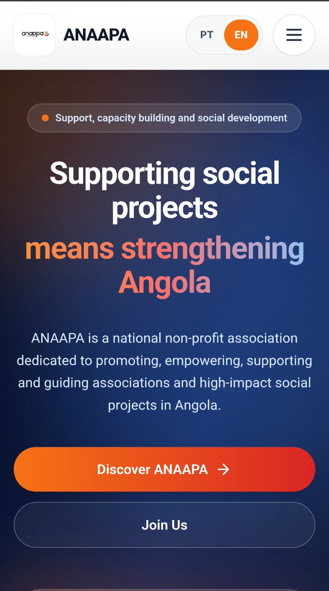
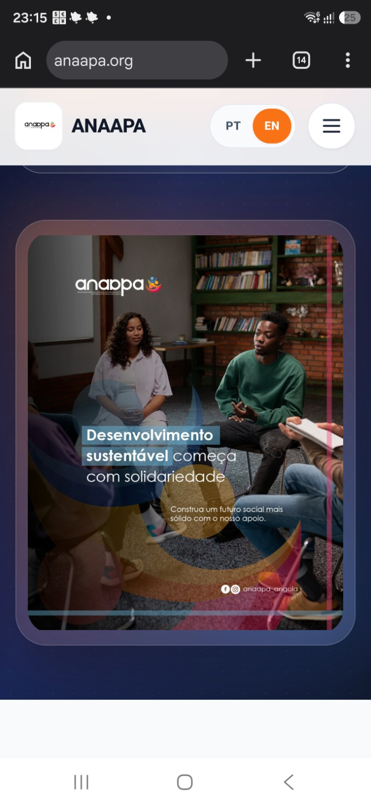
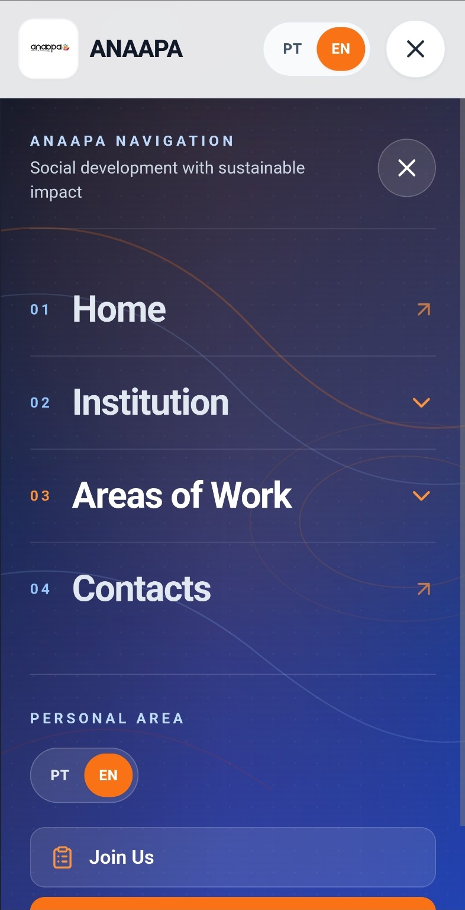
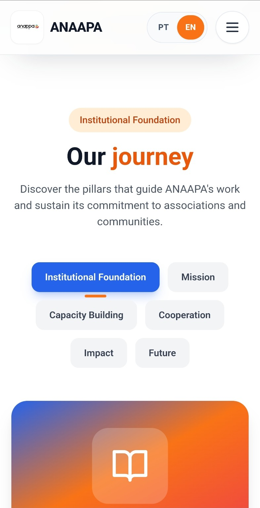
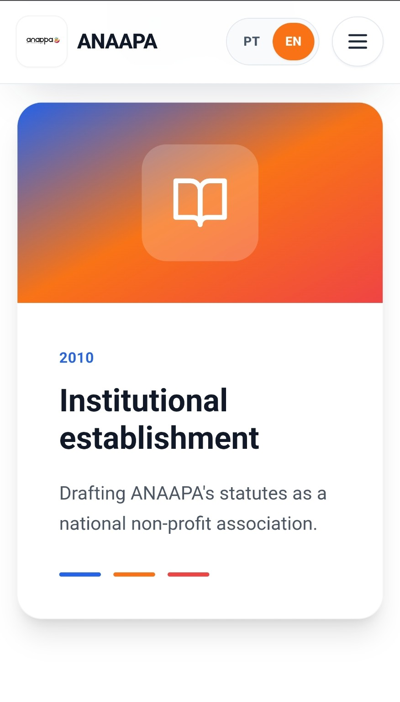
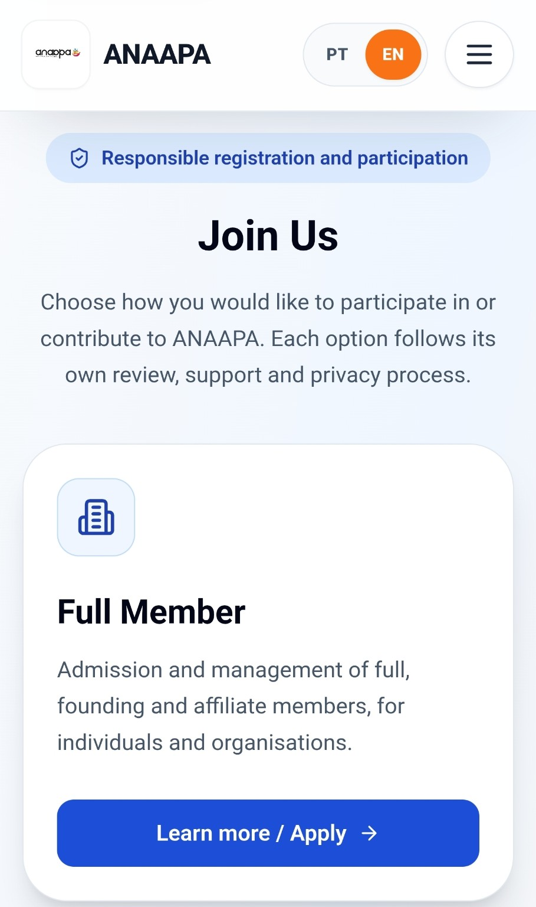
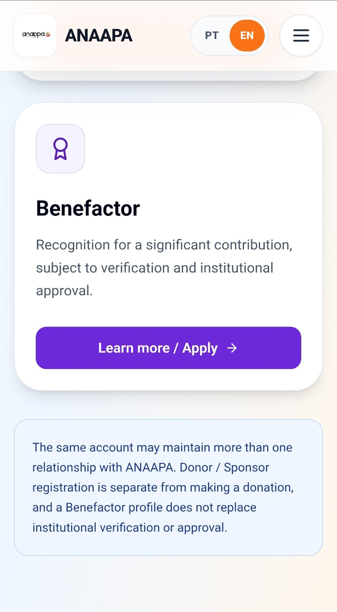

<div align="center">

# ANAAPA — Institutional Digital Platform

### A real-world web platform supporting social development and nonprofit engagement in Angola

**React · TypeScript · Vite · Supabase · Responsive Web Design**

[🌐 Live Website](https://anaapa.org) · [📸 Screenshots](#-interface-gallery) · [🇵🇹 Resumo em português](#-resumo-em-português)



</div>

> **Portfolio case study — private source code.** This repository documents a project I developed for ANAAPA. It is not a copy of the organisation's private production repository. Screenshots are provided for portfolio purposes; all institutional branding and content belong to their respective owners.

## ✨ Project overview

**ANAAPA** is a nonprofit association in Angola focused on supporting associations, strengthening institutional capacity and promoting social-impact initiatives.

I worked on the development and evolution of its institutional web platform, translating organisational requirements into a responsive digital experience. The project involved more than implementing pages: it required understanding stakeholders' needs, designing user journeys, integrating authentication and data services, responding to testing feedback and deploying changes to a live website.

**Project type:** Real client / institutional website  
**My role:** Web developer — implementation, integration, testing and deployment  
**Status:** Live, with ongoing improvements  
**Website:** https://anaapa.org

## 🎯 Goals

- Establish a clear and credible online presence for the association.
- Present its mission, history, areas of activity and institutional structure.
- Support membership applications and controlled access to relevant services.
- Provide paths for supporters, donors and benefactors to engage with ANAAPA.
- Deliver an accessible, mobile-friendly navigation experience.
- Build a foundation that can evolve as the association's needs grow.

## 🧩 Features and product areas

| Area | Description |
| --- | --- |
| Institutional pages | Presentation of ANAAPA, its history, mission and areas of work. |
| Responsive navigation | Mobile menu, structured sections and clear calls to action. |
| Multilingual interface | Portuguese and English language selection visible in the current interface. |
| Membership journeys | Application and participation pathways for different association relationships. |
| Authentication | Account registration and email confirmation, with protected access to restricted areas. |
| Document workflows | Member-facing document upload and download journeys included in the testing scope. |
| Institutional content | Presentation of organisational information, members and related content. |
| Donations | Donor-oriented access and workflows; payment methods and operational details require institutional confirmation before claiming live payment processing. |
| Contact | Institutional contact flow and form integration. |

## 🛠️ Technology stack
<p align="center">
  
  
  
  
  
  
</p>

> This is a high-level architecture description, not a disclosure of private implementation details.

## 🏗️ Architecture at a glance

```text
Visitors / Members
       │
       ▼
React + TypeScript + Vite
       │
       ├── Public institutional pages
       ├── Membership and contact journeys
       ├── Language selection and responsive UI
       └── Protected member experiences
                    │
                    ▼
                Supabase
          ┌─────────┼─────────┐
          ▼         ▼         ▼
         Auth    Database   Storage

Production website → Hostinger
Source control     → Private GitHub repository
```

## 📸 Interface Gallery

The following screenshots showcase the responsive mobile experience of the live platform.

### Homepage and Visual Identity

<table>
  <tr>
    <td align="center" valign="top">
      
    </td>
    <td align="center" valign="top">
      
    </td>
  </tr>
  <tr>
    <td align="center"><b>Mobile Homepage</b></td>
    <td align="center"><b>Social Impact & Visual Identity</b></td>
  </tr>
</table>

### Navigation and Institutional Storytelling

<table>
  <tr>
    <td align="center" valign="top">
      
    </td>
    <td align="center" valign="top">
      
    </td>
    <td align="center" valign="top">
      
    </td>
  </tr>
  <tr>
    <td align="center"><b>Responsive Navigation</b></td>
    <td align="center"><b>Institutional Journey</b></td>
    <td align="center"><b>Interactive Timeline</b></td>
  </tr>
</table>

### Membership and Participation

<table>
  <tr>
    <td align="center" valign="top">
      
    </td>
    <td align="center" valign="top">
      
    </td>
  </tr>
  <tr>
    <td align="center"><b>Membership Application</b></td>
    <td align="center"><b>Benefactor Program</b></td>
  </tr>
</table>

Explore the live platform: [anaapa.org](https://anaapa.org)


## 🔐 Security and responsible development

- Implemented authenticated access patterns for restricted experiences.
- Used email confirmation as part of the account-registration journey.
- Worked with Supabase access controls and storage services.
- Kept application secrets and private configuration out of this public portfolio repository.
- Considered personal-data protection and member validation during implementation.

**Important:** These points describe development practices and implemented workflows; they are not a claim of a formal security audit or compliance certification.

## 🧪 Testing, feedback and iteration

The platform was reviewed with a **14-person testing group**, using mobile devices and computers. Testing scenarios included registration, confirmation emails, document handling, navigation, links and error reporting with screenshots.

The feedback cycle helped identify and prioritise usability issues, visual adjustments and workflow improvements. This was an important part of the project: receiving feedback, clarifying requirements and refining the product while maintaining the live website.

## 🚀 Delivery and project workflow

1. Gathered and clarified requirements with institutional stakeholders.
2. Structured the frontend and connected supporting services.
3. Implemented public pages, user flows and protected areas.
4. Tested functionality and responsiveness across devices.
5. Managed changes with Git and GitHub.
6. Published updates to the live hosting environment and iterated from feedback.

## 💡 What I learned

This project strengthened both my technical and professional skills:

- **Requirements engineering:** listening carefully to stakeholders and turning needs into actionable features.
- **Frontend engineering:** creating responsive, consistent interfaces and user journeys.
- **Backend integration:** connecting authentication, data and file-management services.
- **Quality assurance:** using structured feedback and real-user testing to improve reliability.
- **Delivery ownership:** working with version control, production deployment and post-release fixes.
- **Communication:** managing differing opinions, explaining technical trade-offs and aligning decisions with the organisation's priorities.

> The most valuable lesson was that successful software development is not just about writing code — it is about understanding the people who will use and depend on the product.

## 🔒 Source code and ownership

The production source code is maintained in a **private repository belonging to ANAAPA**. For confidentiality and intellectual-property reasons, this public repository contains only a project overview and selected screenshots, not the application's source code, environment variables, database schemas or personal information.

**Live project:** [anaapa.org](https://anaapa.org)

## 🇵🇹 Resumo em português

A **ANAAPA** é uma associação angolana sem fins lucrativos. Desenvolvi e acompanhei a evolução da sua plataforma institucional, utilizando **React, TypeScript, Vite e Supabase**, com foco na experiência do utilizador, autenticação, fluxos de adesão, responsividade e integração de serviços.

Participei no levantamento e clarificação de requisitos, implementação de funcionalidades, testes com utilizadores, correção de problemas e publicação de atualizações em produção. Este projeto permitiu-me consolidar competências técnicas e, sobretudo, a capacidade de transformar necessidades reais de uma organização numa solução digital funcional.

O código-fonte pertence a um repositório privado da associação. Este repositório público é exclusivamente uma apresentação do projeto para o meu portefólio profissional.

---

<div align="center">

**Built with purpose · Developed for real people · Continuously improving**

[Visit ANAAPA](https://anaapa.org)

</div>

